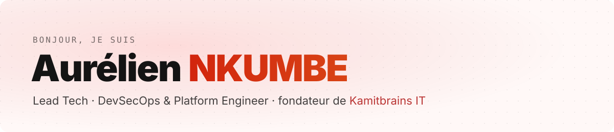

<!--
  Profil volontairement sobre : aucun service de statistiques tiers (ils tombent en panne,
  et une chaîne d'approvisionnement cassée sur un profil DevSecOps plaide contre son auteur).
  Chaque badge reflète un état réel (CI, étoiles) ; la bannière est un SVG versionné ici.
-->

  <picture>
    <source media="(prefers-color-scheme: dark)" srcset="assets/banner-dark.svg">
    <source media="(prefers-color-scheme: light)" srcset="assets/banner-light.svg">
    
  </picture>

  
  
  
  

Je suis **Lead Tech** chez **DATA2INNOV** (santé connectée, FHIR/HL7) et fondateur de **[Kamitbrains IT](https://nkaurelien.kamitbrains.fr/fr/kamitbrains)**. Depuis plus de 7 ans, j'industrialise des architectures sécurisées et conformes (santé / HDS, RGPD), de la spec à la production, et je fais monter les équipes en compétence.

---

## Ce que je fais

- 🔒 **DevSecOps & plateforme** : CI/CD GitLab, Docker, Ansible, Terraform, Kubernetes, observabilité (Grafana, Loki, SigNoz), sécurité des dépendances (Snyk).
- 🏥 **Santé connectée** : applications patient / médecin (Next.js, FastAPI), capteurs IoT (EmotiBit, Withings, Bangle.js), pipelines temps réel, normes FHIR/HL7.
- 🤖 **IA appliquée** : RAG (pgvector, LangChain, Genkit), agents outillés, serveurs MCP, et le développement assisté par IA (Claude Code, Spec-Driven Development).

**Stack principale :** `TypeScript` `Python` `PHP` · `Next.js` `Angular` `FastAPI` `Laravel` · `Docker` `Kubernetes` `Terraform` `Ansible` `GitLab CI` · `PostgreSQL` `pgvector`

---

## En vitrine

### 🧠 [nkaurelien.kamitbrains.fr](https://nkaurelien.kamitbrains.fr) — un portfolio qui répond à vos questions

  
  
  
  

**Le problème :** un recruteur n'a pas le temps de lire un CV de 3 pages ni 30 articles de blog.

**La réponse :** [Jamila](https://nkaurelien.kamitbrains.fr/fr/chat), une assistante IA qui répond à partir de mon profil et de mes articles.

- **RAG** sur Postgres + pgvector (Neon), embeddings locaux `all-MiniLM-L6-v2`, bascule automatique entre Gemini et Claude.
- **Outils visibles en direct** : elle cherche, liste et lit les articles, et chaque étape s'affiche dans sa réponse.
- **Serveur MCP** (`/api/mcp`) : les mêmes outils, exposés à Claude ou à tout client MCP, protégés par clé.
- **Sûr par conception** : elle peut préparer un message pour moi, mais c'est le visiteur qui l'envoie (hCaptcha vérifié côté serveur).
- **Accessible** : tests d'interface et WCAG 2.1 AA (axe-core) en clair et en sombre à chaque changement.

### Autres projets

| Projet | En une ligne | |
|---|---|---|
| [**momopay**](https://github.com/nkaurelien/momopay) | Paiement Mobile Money au Cameroun |  |
| [**mise-devtools**](https://github.com/nkaurelien/mise-devtools) | Un poste de dev reproductible avec mise-en-place |  |
| [**webmethods-devops-portfolio**](https://github.com/nkaurelien/webmethods-devops-portfolio) | Infra webMethods Command Central en Terraform + Ansible + Docker | |
| [**fhir-nextjs-starter**](https://github.com/nkaurelien/fhir-nextjs-starter) | Point de départ Next.js pour une application santé FHIR/HL7 | |

---

  <b>Une question sur mon parcours ?</b> <a href="https://nkaurelien.kamitbrains.fr/fr/chat">Demandez à Jamila →</a>

